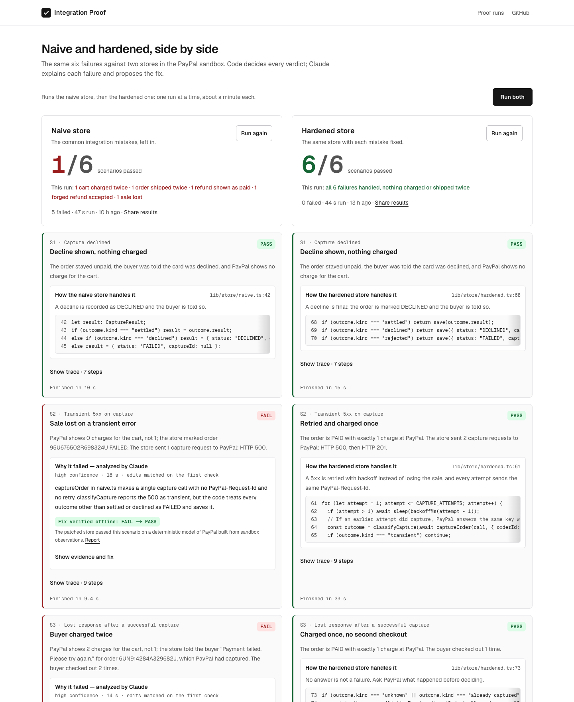
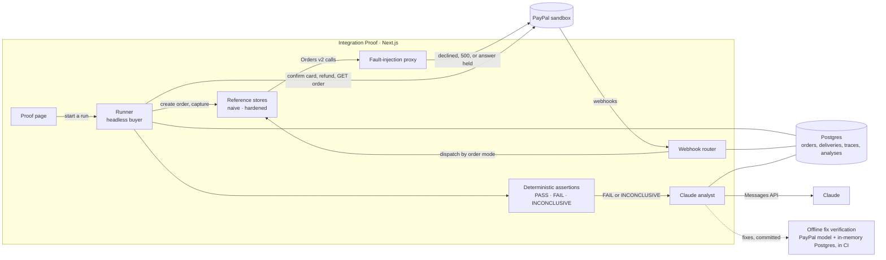
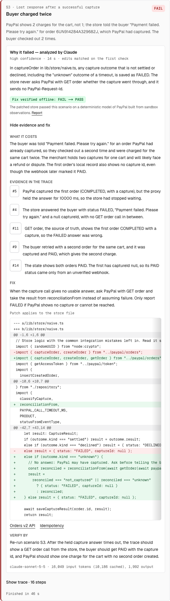

# Integration Proof

Prove your PayPal integration survives a bad day, before your customers find out.

[](https://github.com/Jasekeee/integration-proof/actions/workflows/ci.yml)
[](https://github.com/Jasekeee/integration-proof/actions/workflows/verify-ai-fixes.yml)
[](LICENSE)

**Live demo: [integration-proof.onrender.com/proof](https://integration-proof.onrender.com/proof)**



Integration Proof runs controlled failures against a PayPal Checkout integration in the PayPal
sandbox. It records every request, response and webhook in a trace, decides PASS or FAIL for each
scenario with deterministic code, and asks Claude for the root cause and a fix. Each fix is then
checked offline: applied to the store, type-checked, and run against the same failure.

## The problem

PayPal captured the payment, but its response reached the store after the store had stopped
waiting. The store read the timeout as a failed payment and told the buyer "Payment failed. Please
try again." The buyer checked out the same cart again, and PayPal captured the second order too. One
lost response, and the buyer paid twice.

Nothing in a happy-path test catches this. Integration Proof makes it happen on purpose, in the
sandbox, and shows what the store did.

## How it works



1. **Inject a failure.** The runner plays the buyer. The store under test sends its PayPal calls
   through a fault-injection proxy, which declines a capture, fails it with a 500, or lets PayPal
   capture and holds the answer past the store's timeout. The runner also replays and forges real
   webhook deliveries.
2. **Decide it with code.** Each scenario ends with a deterministic assertion that compares what the
   store believes with PayPal's own record of every order created for the buyer's cart. The model
   never decides a verdict.
3. **Explain and fix with Claude.** For each failure, Claude reads the trace and the store's code,
   names the root cause and what it costs, cites the trace steps that show it, and proposes a fix.
4. **Verify the fix offline.** The proposed fix is applied to the store and the scenario is run
   again on a deterministic model of PayPal, in CI.

More detail in [docs/architecture.md](docs/architecture.md).

## Scenarios

Two reference stores run side by side. The naive store keeps the common integration mistakes; the
hardened store is the same store with each one fixed. In the live sandbox the naive store passes 1
of 6, the hardened store 6 of 6.

| | Failure | How it is produced | Naive store | Hardened store |
|---|---|---|---|---|
| S1 | Capture declined | The proxy adds `PayPal-Mock-Response: INSTRUMENT_DECLINED` to the capture | Shows a decline, charges nothing | Same |
| S2 | Transient 5xx on capture | The first capture gets a mocked `500 INTERNAL_SERVER_ERROR` | Marks the order failed: a sale lost from a buyer ready to pay | Retries with backoff and the same `PayPal-Request-Id`; charged once |
| S3 | Lost response after a successful capture | PayPal captures; the proxy holds the answer past the store's timeout | Says "Payment failed"; the buyer checks out again and is charged twice for one cart | Asks `GET /v2/checkout/orders/{id}`, sees the capture, marks the order paid |
| S4 | Duplicate webhook | The same real `PAYMENT.CAPTURE.COMPLETED` is delivered twice | Ships the order twice | Dedupes by event id; ships once |
| S5 | Late `COMPLETED` after a refund | The merchant refunds; a stale `COMPLETED` arrives last | Shows the refunded order as paid | Reads the order from PayPal; stays refunded |
| S6 | Forged webhook | A recorded delivery with its body changed after PayPal signed it | Accepts the forged refund | Signature verification fails; answers 400 and changes nothing |

PayPal allows one capture per order, so no store here can charge the same order twice. The harms the
product shows are the ones that really happen: a lost sale (S2), a second charge on a second order
for the same cart (S3), a double shipment (S4), and order states that disagree with PayPal (S5, S6).

## How PayPal is used

Every PayPal behaviour the product relies on was observed in the sandbox first and recorded, with
its `debug_id`, in [docs/sandbox-findings.md](docs/sandbox-findings.md).

- **[Orders v2](https://developer.paypal.com/api/orders/v2).** The store creates an order with no
  payment source. The headless buyer sends PayPal's published
  [sandbox test card](https://developer.paypal.com/tools/sandbox/card-testing/) to
  [`confirm-payment-source`](https://developer.paypal.com/api/orders/v2/orders-confirm), and the
  order becomes `APPROVED`. The store then captures in a separate request, which is the one the
  proxy faults. `GET /v2/checkout/orders/{id}` is the source of truth for every verdict.
- **[Idempotency](https://developer.paypal.com/api/rest/reference/idempotency/).** The hardened
  store sends one `PayPal-Request-Id` per logical operation. A retried capture with the same key
  returns the original capture (200); a new key gets `422 ORDER_ALREADY_CAPTURED`.
- **[Negative testing](https://developer.paypal.com/tools/sandbox/negative-testing/request-headers/).**
  The proxy injects `PayPal-Mock-Response` with `INSTRUMENT_DECLINED` (S1) or
  `INTERNAL_SERVER_ERROR` (S2). A mocked 500 is not stored against the key, so a retry captures.
- **[Refunds](https://developer.paypal.com/api/payments/v2).** S5 refunds the capture through
  Payments v2 as the merchant would, then replays the stale `COMPLETED` event.
- **[Webhooks](https://developer.paypal.com/api/rest/webhooks/).** One webhook is registered for
  `PAYMENT.CAPTURE.*` events. The hardened store verifies every delivery with
  [`verify-webhook-signature`](https://developer.paypal.com/api/webhooks/v1) and applies an event
  id once.

PayPal calls go through a small fetch client with an injectable base URL, so a run can route the
store through the proxy. The server SDK has no base URL option
([decision](docs/decisions.md#paypal-calls-use-our-fetch-client-not-the-server-sdk)).

## How Claude is used



When a scenario fails, an analyst (`lib/ai/analyst.ts`) asks Claude (`claude-sonnet-5-5`, set by
`ANTHROPIC_MODEL`) why. It sends the scenario, the verdict, the redacted trace, the store file under
test in full, and the declarations of the modules the store can call.

- **Code decides the verdict.** Assertions are deterministic and run before the model is asked. The
  analysis explains a verdict; it never changes one.
- **Every answer is checked.** Claude answers in a zod-validated structure: root cause, business
  impact, evidence, fix, documentation links and confidence. Every evidence item must cite a step
  that exists in the trace, and on the page it scrolls to that row. Links must point to PayPal's
  documentation. An invalid answer gets one retry with the reasons; after that the analysis is
  marked unavailable and the verdict stands.
- **Edits, not diffs.** Claude writes the fix as edits that quote the store file. Code checks that
  each quote occurs exactly once, applies the edits and builds the diff itself. A quote that does not
  match gets one self-check round, in which Claude sees the file's own lines with their indentation
  made visible. If it still does not match, the patch is marked "needs review".
- **Prompt-injection guard.** The trace is data from PayPal, webhook deliveries and the store, and
  S6 sends a forged webhook on purpose. It goes into an `<untrusted_trace>` section in which nothing
  can close or open a tag. An operator message after it repeats that the trace is data, not
  instructions.
- **Caching.** An analysis is cached under a hash of the scenario, the model, the store code and the
  shape of the trace, so a store that fails the same way again costs no tokens. The store code sits
  behind a prompt-cache breakpoint shared by the analyses of one run.
- **Traced.** Every model call is a step of the scenario's trace, with tokens, duration and outcome.

## Verified fixes

Claude's fixes for S2 to S6 are committed to [`fixtures/ai-fixes/`](fixtures/ai-fixes) and checked
by [`scripts/verify-ai-fixes.ts`](scripts/verify-ai-fixes.ts) in CI. Each patch is applied to a
copy of the naive store and type-checked. All six scenarios then run against the patched store on
an offline bench.

| Scenario | Patch applies | Types | Before | After | Other scenarios |
|---|---|---|---|---|---|
| S2 · Sale lost on a transient error | yes | yes | FAIL | **PASS** | unchanged |
| S3 · Buyer charged twice | yes | yes | FAIL | **PASS** | unchanged |
| S4 · Order shipped twice | yes | yes | FAIL | **PASS** | S5 FAIL → PASS |
| S5 · Refunded order shown as paid | yes | yes | FAIL | **PASS** | S4 FAIL → PASS |
| S6 · Forged refund accepted | yes | yes | FAIL | **PASS** | unchanged |

The bench runs the real runner, routes, proxy, stores and assertions against a deterministic model
of PayPal built from the behaviour recorded in the sandbox findings, and an in-memory Postgres. A
call the model does not cover is refused, and a run that made one does not count. Before it rules on
a fix, the bench must reproduce the live verdicts: naive 1/6, hardened 6/6. This is not a run
against the live sandbox; the full report is in [docs/ai-fixes-report.md](docs/ai-fixes-report.md).

## Security

- **Sandbox only.** A hard allowlist admits `api-m.sandbox.paypal.com` and the run's own proxy; any
  other PayPal base URL throws before a request leaves the process. The proxy forwards only the
  Orders v2 calls a store makes.
- **Secrets stay in the environment.** They live in `.env.local` and the hosting provider, are never
  logged, and never use a `NEXT_PUBLIC_` name. Traces are redacted before they are stored.
- **Model-generated code never runs on the server.** Patches run only in the offline check, from
  committed files, in a process with no secrets, and in CI with no network.
- **Per-scenario secret tokens.** Each scenario gets a random 256-bit key that routes the store
  through the proxy. Run ids are public; keys are never returned by the API.
- **Rate limits.** One run at a time, and at most 20 runs per hour.

To report a vulnerability, see [SECURITY.md](SECURITY.md).

## Honest limits

- **Sandbox only.** The product never touches live payments.
- **Reference stores.** It proves two stores built to show the method, not your store yet.
- **Webhook delivery takes time.** In recorded full proofs a scenario's webhooks arrived 7 to 60
  seconds after its last call to PayPal, and once took 138 seconds for two deliveries. A scenario that needs a
  webhook waits up to 150 seconds. If PayPal has not delivered by then, the verdict is
  **INCONCLUSIVE**, not FAIL: the store was never tested.
- **The offline bench is a model.** It covers the PayPal behaviour observed in the sandbox and
  nothing more. A fix that relies on behaviour nobody has observed, such as a redelivery after a
  5xx, is not counted.
- **Not covered yet:** 3-D Secure and `PAYER_ACTION_REQUIRED`, partial refunds, pending captures.

## Try it in 60 seconds

1. Open [integration-proof.onrender.com/proof](https://integration-proof.onrender.com/proof). The page
   opens with the latest results of both stores.
2. Open a red card. Read Claude's root cause, click an evidence step to jump to it in the trace, and
   see the fix and its offline verdict.
3. Click **Run both** to run the six failures again: the naive store, then the hardened one, about a
   minute each. The demo runs one proof at a time for everyone.

## Quick start

You need Node.js 24, a PayPal sandbox REST app, a Postgres database (Neon works) and, for the
analyses, an Anthropic API key.

```bash
git clone https://github.com/Jasekeee/integration-proof.git
cd integration-proof
cp .env.example .env.local   # every variable is documented there
npm ci
npm run db:migrate
npm run dev                  # http://localhost:3000/proof
```

PayPal delivers webhooks only to a public HTTPS URL, registered on the sandbox app as
`https://<host>/api/store/webhooks-router`. Without one, S1 to S3 run as usual, and S4 to S6, which
need a delivery, end INCONCLUSIVE.

The offline bench needs no account at all:

```bash
npx vitest run bench                       # naive 1/6, hardened 6/6 on the PayPal model
npx tsx scripts/verify-ai-fixes.ts --check # Claude's committed fixes, verified offline
```

## Documentation

- [docs/architecture.md](docs/architecture.md): components, a run step by step, data model.
- [docs/decisions.md](docs/decisions.md): engineering decisions and their reasoning.
- [docs/sandbox-findings.md](docs/sandbox-findings.md): PayPal sandbox behaviour, as observed.
- [docs/ai-fixes-report.md](docs/ai-fixes-report.md): Claude's fixes, verified offline.

## Roadmap

- **Your own store.** Point the runner at any store that implements the small contract the
  reference stores use: create, capture, a state endpoint and a webhook route.
- **More failures.** 3-D Secure and `PAYER_ACTION_REQUIRED`, partial refunds, pending captures, and
  webhook redelivery after a 5xx.
- **Proof in pull requests.** A GitHub Action that runs the proof against a preview deployment and
  comments the verdicts on the pull request.
- **Fixes as pull requests.** Open a verified fix from Claude as a pull request against the store.

## License

[MIT](LICENSE)
