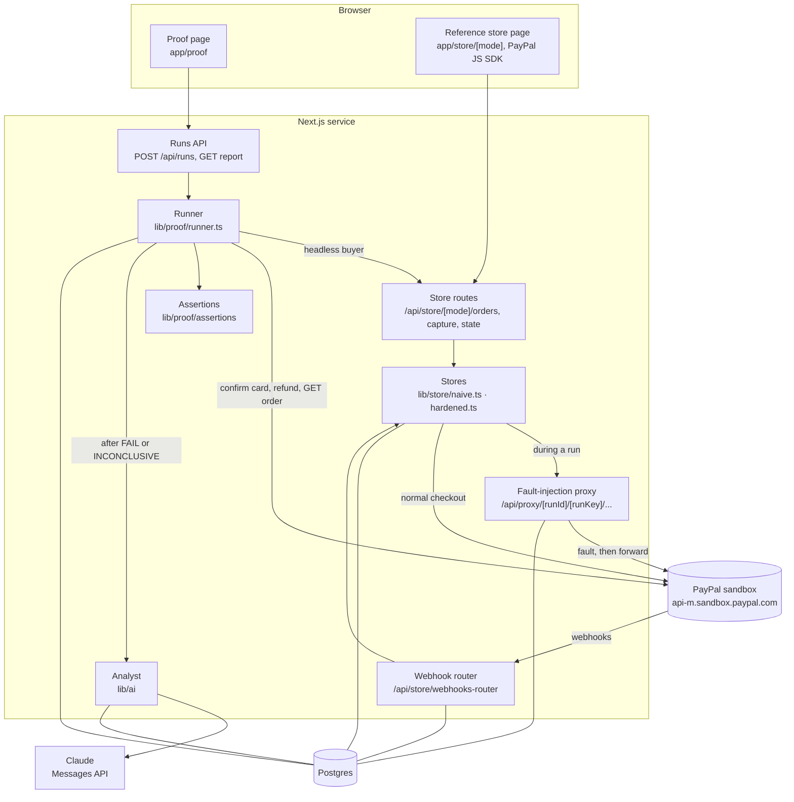
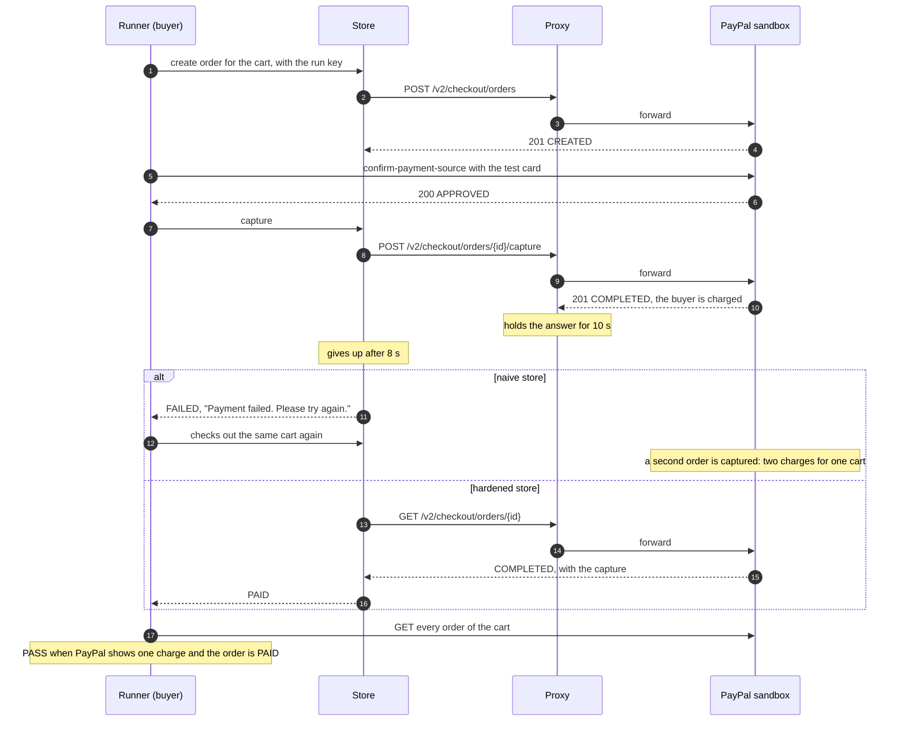
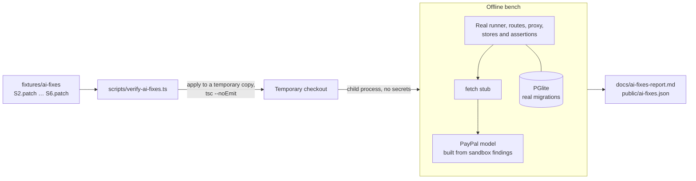
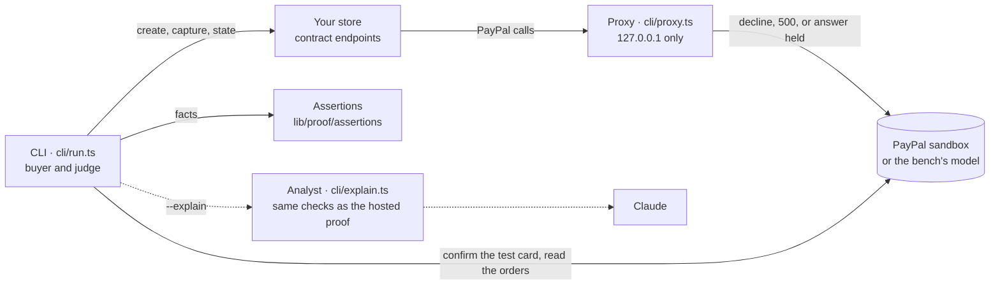

# Architecture

Integration Proof is one Next.js application, deployed as one service on Render, with one Postgres
database on Neon. A command-line tool in `cli/` runs the checkout scenarios against a store of your
own, from your machine ([Proving your own store](#proving-your-own-store-the-cli)). The reasons
behind each choice below are in [decisions.md](decisions.md); the PayPal behaviour it relies on is
in [sandbox-findings.md](sandbox-findings.md).

## Components



- **Proof page.** Shows both stores side by side with their latest runs and polls a run while it
  is in progress.
- **Runner.** Executes a run's scenarios in parallel. It plays the buyer, makes the merchant's
  refund, waits for PayPal's webhooks, replays or forges deliveries, reads PayPal's record of every
  order, and hands the facts to the scenario's assertion.
- **Reference stores.** Two implementations of the same store behind the same routes. The mode is in
  the URL and on every order row; nothing is switched by configuration.
- **Fault-injection proxy.** Forwards a store's Orders v2 calls to the sandbox during a run and
  injects the scenario's fault: a `PayPal-Mock-Response` header, or an answer held past the store's
  timeout.
- **Webhook router.** The one URL registered with PayPal. It records every delivery byte for byte
  and hands it to the store that owns the order.
- **Assertions.** Pure functions of the trace and the state that decide PASS or FAIL.
- **Analyst.** Asks Claude to explain a failure and propose a fix, checks the answer, and caches it.

## A run, step by step

1. `POST /api/runs` creates the run and one row per scenario, each with its own cart and a random
   256-bit run key. One run may be live at a time, and all visitors together may start sixty runs
   an hour (lib/proof/limits.ts). The code also limits runs per visitor, but the deployed service
   cannot tell visitors apart, so that limit is set equal to the overall one
   ([decisions](decisions.md#the-deployed-service-does-not-see-a-visitors-address)).
2. The runner starts all scenarios at once. Scenarios share nothing but the database.
3. As the buyer, the runner asks the store to create an order and passes the scenario's run key.
   The store then sends that order's PayPal calls to `/api/proxy/{runId}/{runKey}`, with the run's
   short timeout of 8 seconds.
4. The runner sends PayPal's published sandbox test card to `confirm-payment-source`; the order
   becomes `APPROVED`.
5. The runner asks the store to capture. The proxy injects the scenario's fault into that request.
6. If the store told the buyer the payment failed (S3), the runner checks out the same cart again,
   as a buyer would.
7. In S5 the runner refunds the capture as the merchant.
8. The runner waits until the store has acknowledged every webhook PayPal sends for the cart, for
   at most 150 seconds. In S4 and S5 it then sends a recorded delivery again, byte for byte; in S6 it
   sends one with its body changed after PayPal signed it.
9. The runner reads every order of the cart from PayPal and the store's own state, and the
   assertion decides PASS or FAIL. A webhook that S4, S5 or S6 needs and PayPal did not deliver in
   time makes the verdict INCONCLUSIVE.
10. A FAIL or INCONCLUSIVE verdict starts an analysis. The run is finished for its viewers while the
    analysis continues.

The runner's own PayPal calls are retried up to three times after a 5xx, a timeout or a network
error. The store's calls are never retried by the runner: how the store handles a failure is what
the scenario measures.

## S3 in detail



The verdict counts charges per cart from PayPal, never from the store's own rows. PayPal allows one
capture per order, so a second charge needs a second order, which is exactly what a buyer told
"Payment failed" creates.

## Webhooks

PayPal delivers `PAYMENT.CAPTURE.*` events to `/api/store/webhooks-router`. The router finds the
order by the store's id in `custom_id`, or by the PayPal order id, and hands the delivery to the
store in the order's mode. Every delivery is stored with its transmission headers and raw body.

Both stores ship an order when its `PAYMENT.CAPTURE.COMPLETED` is applied. The naive store applies
each event's status in arrival order and checks nothing. The hardened store:

1. verifies the delivery with `POST /v1/notifications/verify-webhook-signature`, and answers 400 when
   PayPal says `FAILURE`;
2. stops at an event id it has already applied;
3. reads the order from PayPal and takes its status from the latest capture, so delivery order does
   not matter;
4. claims the event id and applies the change in one transaction, with the primary key on the
   event id as the dedupe.

## Analysis

```mermaid
flowchart LR
  verdict["FAIL or INCONCLUSIVE"] --> key{"Cached?<br/>hash of format, scenario,<br/>model, store code, trace"}
  key -->|"yes"| reuse["Reuse the analysis<br/>no tokens"]
  key -->|"no"| call["Claude: structured answer"]
  call --> check{"Valid?<br/>schema, evidence steps,<br/>docs links, no PayPal ids"}
  check -->|"no, once"| call
  check -->|"no, twice"| unavailable["Analysis unavailable<br/>verdict stands"]
  check -->|"yes"| edits{"Edits match the file?<br/>each find exactly once"}
  edits -->|"yes"| diff["Code builds the diff"]
  edits -->|"no, once"| selfcheck["Self-check round<br/>file lines, visible indentation"] --> call
  edits -->|"no, after the round"| review["Patch needs review"]
```

The model receives the scenario, the verdict and its reason, the redacted trace, the store file under
test in full, and the exported declarations of the modules the store can call. The trace sits in an
`<untrusted_trace>` section with `<` escaped, followed by an operator message that it is data. Every
model call is written to the scenario's trace.

## Offline fix verification



`scripts/export-ai-fixes.ts` saves Claude's fixes from a run, only when their cache keys prove they
were written for the store code in the checkout. `scripts/verify-ai-fixes.ts` first checks that the
bench reproduces the live verdicts, then applies each fix and runs all six scenarios against the
patched store. CI runs it in a network namespace with no interface and fails when the committed
report is out of date. The server only reads `public/ai-fixes.json`.

## Proving your own store: the CLI

`npm run cli -- run` proves a store that implements the
[store contract](store-contract.md) against S1–S3. It runs on the developer's machine and uses the
same scenario definitions and assertions as the hosted proof; the deployed service is not involved.



- **Proxy.** Started by the CLI on `127.0.0.1`; the store's PayPal base URL points at it, and it
  injects the running scenario's fault before forwarding.
- **PayPal or its model.** `--paypal sandbox` uses the real sandbox with the store's own app;
  `--paypal model` (`cli/model.ts`) answers from the bench's model of PayPal and needs no account or
  network, which is what CI uses for `examples/express-store`.
- **Verdicts.** PayPal's record of the cart and the store's state endpoint go into the same
  assertions as the hosted proof. The console, `report.json` and a Markdown summary report them.
- **Claude, opt-in.** With `--explain --source <dir>`, the CLI lists the files it will send, redacts
  secret-looking values, and asks the same analyst for a root cause and a fix. `--write-patch` writes
  the checked fix as a diff; the CLI never applies or runs it.

## Data model

| Table | Holds |
|---|---|
| `runs` | A proof run: store mode, status, timeouts, start and finish |
| `run_scenarios` | One scenario of a run: its cart, its secret run key, verdict, reason, headline, harm, and the link to its analysis |
| `trace_steps` | Every step of a scenario: actor, method, path, status, `debug_id`, `PayPal-Request-Id`, fault, redacted bodies |
| `orders` | The stores' orders, with mode, cart, PayPal order id, status and capture id |
| `webhook_deliveries` | Every delivery the router received, byte for byte, with its verification and outcome |
| `webhook_events` | Event ids the hardened store applied; the primary key is its dedupe |
| `fulfilments` | Shipments; no unique constraint, so a store can ship twice |
| `analyses` | Claude's analyses, keyed by the cache key, with the checked result, patch status and token use |

## Deployment

- Render runs `npm ci && npm run db:migrate && npm run build`, then `next start`, on Node.js 24.
  Migrations only add and apply before the build, so a failed migration keeps the previous deploy.
- Postgres is Neon, reached over TLS with certificate verification through node-postgres.
- Configuration comes from the environment; `.env.example` lists every variable.
- `GET /api/health` answers without touching the database or PayPal and reports the deployed commit.
