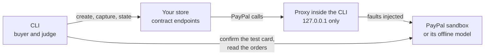

# Store contract, version 1

Integration Proof can prove a store other than its two reference stores. The store implements the
small contract on this page, and the CLI in `cli/` runs the checkout scenarios S1–S3 against it from
your machine. The verdicts come from the same deterministic assertions as the hosted proof
(`lib/proof/assertions`).

```bash
npm run cli -- run --store http://localhost:4000/integration-proof
```

Version 1 covers **S1 (capture declined), S2 (transient 5xx on capture) and S3 (lost response after a
successful capture)**. The webhook scenarios S4–S6 are not part of it; see
[What version 1 does not cover](#what-version-1-does-not-cover).

## How a run works



1. **Start the proxy.** The CLI starts a fault-injection proxy on `127.0.0.1` (port 8787 by default).
2. **Point the store at it.** Your store, started with its PayPal base URL set to that proxy, sends
   every PayPal call there. The proxy forwards it to the sandbox, after injecting the running
   scenario's fault.
3. **Run the scenarios one after another, each with its own cart.** In each one the CLI, as the
   buyer:
   1. asks the store to create an order;
   2. approves the order with PayPal's published sandbox test card (`confirm-payment-source`);
   3. asks the store to capture it.

   In S3, when the store tells the buyer the payment failed, the buyer checks out the same cart
   again.
4. **Read the facts.** The CLI reads every order of the cart from PayPal, which is the source of
   truth, and the store's own state from its state endpoint.
5. **Judge.** The assertions decide PASS or FAIL from the trace and the two states. No model is
   involved.

The proxy never leaves your machine: our hosted service is not involved and calls no URL of yours.

## The three endpoints

Your store serves them under a base URL of your choice, which you pass as `--store`. For example,
with `--store http://localhost:4000/integration-proof`:

| Request | What the store does | Answer |
|---|---|---|
| `POST {base}/orders` with `{"cartId": "..."}` | Creates a PayPal order (Orders v2) with `intent: CAPTURE` and **no payment source**, and remembers it under the cart. | `201` with `{"orderId": "<PayPal order id>"}` |
| `POST {base}/orders/{orderId}/capture` | Captures the order with its own capture code, in this separate request, and answers as it would answer the buyer. | Any status, with `{"status": "...", "message": "..."}` |
| `GET {base}/state?cartId=...` | Reports what the store believes about every order of the cart. | `200` with `{"contract": 1, "orders": [{"paypalOrderId": "...", "status": "...", "fulfilments": 0}]}` |

**Order statuses**

`status` is one of `CREATED`, `PENDING`, `PAID`, `DECLINED`, `FAILED` and `REFUNDED`. Map your own
states onto these.

**Carts**

`cartId` is up to 64 characters from `A–Z a–z 0–9 _ -`. A cart can have more than one order: in S3
the buyer checks out the same cart twice.

**The capture answer**

What the store tells the buyer is evidence. For example, in S3 a store that says `FAILED` for an
order PayPal captured fails. Answer with the store's real message.

**Contract version**

The state endpoint answers `"contract": 1`. A later version of the contract will raise it, and the
CLI refuses an answer it cannot read.

The CLI validates every answer against these shapes (`cli/contract.ts`). An answer outside the
contract stops that scenario with `ERROR` and names what was expected.

## What the store must allow

- **A configurable PayPal base URL, used for every PayPal call.** During a run, point it at the
  proxy, e.g. `PAYPAL_API_BASE=http://127.0.0.1:8787`. This covers the OAuth token
  (`POST /v1/oauth2/token`), which the proxy forwards untouched and never records. The proxy
  forwards only the token and these Orders v2 calls:
  - `POST /v2/checkout/orders`;
  - `GET /v2/checkout/orders/{id}`;
  - `POST /v2/checkout/orders/{id}/capture`.

  Anything else gets a 404 and never reaches PayPal.
- **A timeout on its PayPal calls, shorter than `--hold-ms`.** S3 holds PayPal's answer to the first
  capture for `--hold-ms` (35 seconds by default, at most 120) after PayPal has captured.
  - A store that stops waiting before then meets a lost response, which is the test.
  - A store that waits the whole time never does. Its S3 ends `INCONCLUSIVE`, with how long it
    waited, rather than a PASS it did not earn.
- **The same PayPal app on both sides.** The CLI uses the store's sandbox credentials
  (`PAYPAL_CLIENT_ID`, `PAYPAL_CLIENT_SECRET`) to approve the test card and to read the orders.
  PayPal only lets the app that created an order do that.

The endpoints are a thin test adapter in front of your checkout. They should call the same create and
capture code your buyers reach. The CLI cannot tell whether they do; a proof is only as real as that
code path.

## Running it

```bash
# 1. Start your store with its PayPal base URL on the proxy, for example:
PAYPAL_API_BASE=http://127.0.0.1:8787 npm start

# 2. From a clone of this repository:
npm ci
npm run cli -- run --store http://localhost:4000/integration-proof --env-file .env.cli
```

`.env.cli` holds `PAYPAL_CLIENT_ID` and `PAYPAL_CLIENT_SECRET` of the store's sandbox app.

[examples/express-store](../examples/express-store) is a complete store that implements this
contract, in plain Express, with two common mistakes. The workflow
`.github/workflows/store-contract.yml` proves it on every pull request with `--paypal model`.
[A sandbox run of the example store](store-contract-sandbox-run.md) shows the same proof against the
real PayPal sandbox, step by step.

### Options

| Option | Default | Meaning |
|---|---|---|
| `--store <url>` | required | The base URL of the three endpoints. |
| `--paypal sandbox\|model` | `sandbox` | `sandbox` is the real PayPal sandbox. `model` is the offline model of the sandbox from `bench/`, which answers only with behaviour recorded in [sandbox-findings.md](sandbox-findings.md); it needs no credentials and no network. |
| `--proxy-port <port>` | `8787` | Where the proxy listens, on `127.0.0.1`. |
| `--hold-ms <ms>` | `35000` | How long S3 holds PayPal's capture answer. |
| `--scenarios <list>` | `S1,S2,S3` | Which scenarios to run. |
| `--expect <list>` | none | Expected verdicts, e.g. `S1=PASS,S2=FAIL,S3=FAIL`. |
| `--out <dir>` | `integration-proof-report` | Where the reports go. |
| `--env-file <path>` | none | Variables to load first. |

### Output

- **A line per scenario** on the console: verdict, what happened and why.
- **`report.json`** with every step of every scenario.
  - Request and response bodies are redacted the same way as in the hosted trace.
  - The OAuth exchange is never recorded.
- **`summary.md`**, a Markdown table. When `GITHUB_STEP_SUMMARY` is set, it is also appended there,
  so a GitHub Actions job shows it on its page.

### Exit codes

| Code | When |
|---|---|
| `0` | Every verdict matched `--expect`, or, without expectations, every scenario passed. |
| `1` | Not as expected. |
| `2` | The run could not start (wrong option, missing credentials, proxy port in use). |

## Claude's analysis of the failures (opt-in)

With `--explain`, the CLI asks Claude why each failed scenario failed, in the store's own code. It
uses the same analyst as the hosted proof (`lib/ai/analyst.ts`):
- the answer is validated against the same schema;
- every piece of evidence must cite a real step of the trace;
- the trace goes in as untrusted data, guarded against instructions hidden in it;
- the fix is a list of find-and-replace edits, each `find` quoted from your file and occurring in it
  exactly once;
- edits that do not match get one round to correct themselves, then are shown as needing review.

```bash
npm run cli -- run --store http://localhost:4000/integration-proof --env-file .env.cli \
  --explain --source src/checkout --write-patch claude-fix.patch
```

| Option | Meaning |
|---|---|
| `--explain` | Ask Claude. Needs `ANTHROPIC_API_KEY`. Without it, nothing is sent anywhere. |
| `--source <path>` | A file or directory of the store's code; repeatable. |
| `--target <file>` | The one file a fix may change. By default, the only file sent, or the one that calls PayPal's capture. |
| `--write-patch <file>` | Write the checked fix as a unified diff. |
| `--model <id>` | The Claude model. By default `ANTHROPIC_MODEL`, else `claude-sonnet-5-5`. |

**What is sent.** For each failed scenario, Claude receives:
- the scenario;
- its verdict and reason;
- its trace, redacted as in `report.json`;
- the source files `--source` selects;
- the names, not the values, of the environment variables the code reads.

Before anything is sent, the CLI prints every file with its size, the total, and every file it left
out with the reason.

**What is never sent.**
- `.env*` files, lockfiles, keys and certificates.
- `node_modules` and build output.
- Anything that is not source code, such as Markdown or JSON configuration.
- Files over 100 KB.

Above 300 KB in all, nothing is sent and the CLI asks for a narrower `--source`. Secret-looking values
in the files are replaced with `[REDACTED]` first, by the same rule as the trace. That covers:
- private keys;
- API keys and access tokens;
- `Bearer` and `Basic` credentials;
- string literals assigned to names such as `secret`, `password` or `token`;
- card numbers that pass the Luhn check.

**What happens to the fix.**
- The CLI checks Claude's edits against your real file on disk and writes the diff itself.
- An edit that touches a redacted line is not turned into a patch.
- With `--write-patch`, the fixes for all failed scenarios are combined in scenario order. A fix that
  overlaps an earlier one is left out and named.
- **The CLI never applies or runs code the model wrote.** You review the patch and apply it yourself
  with `git apply`.
- The verdicts are decided by code before Claude is asked, and the analysis never changes them.

The analysis appears on the console, in `summary.md` and in `report.json`.
[Claude explains the example store's failures](store-contract-claude-run.md) shows a whole run:
1. the two failures;
2. the analysis;
3. the patch;
4. the patched copy passing.

## What version 1 does not cover

- **S4–S6 (duplicate, late and forged webhooks).** PayPal delivers webhooks only to a public HTTPS
  URL registered on the app, so these scenarios need the store deployed or reachable through a
  tunnel. They also need the deliveries recorded with their transmission headers, so they can be
  replayed and forged. A later version of the contract will add them; version 1 states nothing about
  webhooks.
- **A published package.** The CLI runs from a clone of this repository; it is not on npm. The
  `bin` entry in `package.json` is kept for a later release.
